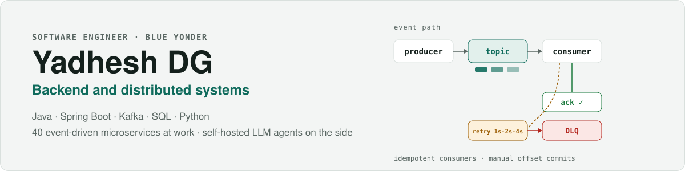
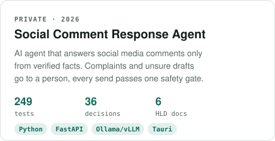
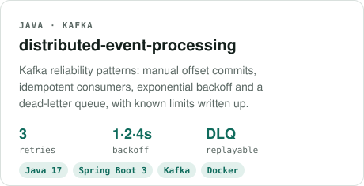
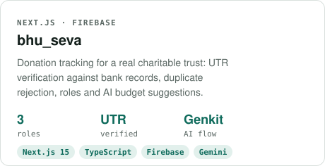
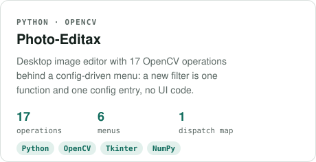

<a href="https://dasariyadhesh.github.io/">
  <picture>
    <source media="(prefers-color-scheme: dark)" srcset="assets/banner-dark.svg">
    
  </picture>
</a>

  
  
  
  

I design and build backend systems that stay correct when things fail: Kafka pipelines with dead-letter queues and idempotent consumers at work, and an AI agent that only answers from verified facts on my own time. I write decisions down with their trade-offs and design the failure path before the happy path.

### Now

**Blue Yonder (Panasonic)** · Software Engineer · Sep 2024 – present
- Distributed platform of **40 microservices over Kafka**: dead-letter queues, idempotent consumers, retries with backoff
- Yard Gate automation (about 60% faster trailer check-in/out), camera-based yard tracking, WMS–YMS discrepancy detection

**Innominds Software** · Associate Software Engineer · May 2022 – Sep 2024
- Built the DS PRO commission engine (Drools rules, 50K+ users); led the OrientDB → MySQL migration of 1M+ records (about 3x faster queries)

### Selected work

<table>
  <tr>
    <td width="50%" valign="top">
      <a href="https://dasariyadhesh.github.io/#comment-agent">
        <picture>
          <source media="(prefers-color-scheme: dark)" srcset="assets/card-agent-dark.svg">
          
        </picture>
      </a>
    </td>
    <td width="50%" valign="top">
      <a href="https://github.com/dasariyadhesh/distributed-event-processing">
        <picture>
          <source media="(prefers-color-scheme: dark)" srcset="assets/card-events-dark.svg">
          
        </picture>
      </a>
    </td>
  </tr>
  <tr>
    <td width="50%" valign="top">
      <a href="https://github.com/dasariyadhesh/bhu_seva">
        <picture>
          <source media="(prefers-color-scheme: dark)" srcset="assets/card-bhuseva-dark.svg">
          
        </picture>
      </a>
    </td>
    <td width="50%" valign="top">
      <a href="https://github.com/dasariyadhesh/Photo-Editax-App-main">
        <picture>
          <source media="(prefers-color-scheme: dark)" srcset="assets/card-editax-dark.svg">
          
        </picture>
      </a>
    </td>
  </tr>
</table>

Each project has a small demo you can run in the browser on the [portfolio](https://dasariyadhesh.github.io/#systems).

### How I work

- **Fail closed.** Retries, dead-letter queues and human review come before automation.
- **One gate for side effects.** Anything that changes the outside world passes one tested chokepoint with idempotency and a kill switch.
- **Decisions on paper.** Alternatives, the trade-off accepted, and when to revisit.
- **Runnable without infrastructure.** Interfaces with in-memory implementations, so a fresh clone runs and tests in seconds.

### Tools

  
  
  
  
  
  
  
  
  
  
  
  
  

